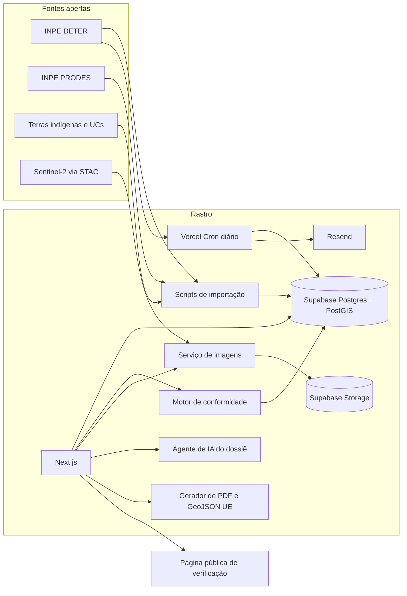

# Rastro: plano de construção

Especificação do produto e roteiro de execução para o Hack Brasil 2026. Leia junto com `CLAUDE.md`.

Datas que mandam no plano:
- Início do código: 4/11/2026, depois das 21h.
- Submissão: até 30/11/2026, 23h59. Meta interna: tudo submetido em 29/11.
- Final presencial: 12/12/2026, no Google Brasil (São Paulo).

---

## 1. Produto

### 1.1 Problema

O Regulamento (UE) 2023/1115 (EUDR) só permite colocar no mercado europeu bovinos, cacau, café, dendê, borracha, soja, madeira e derivados se forem livres de desmatamento posterior a 31/12/2020 e produzidos conforme a legislação do país de origem. As obrigações passam a valer em 30/12/2026 para médias e grandes empresas e em 30/06/2027 para micro e pequenas. O exportador precisa entregar a geolocalização das áreas de produção: polígono para áreas acima de 4 hectares.

As grandes tradings têm sistemas próprios de rastreabilidade. O pequeno produtor e a cooperativa não têm, e correm o risco de perder o comprador europeu.

### 1.2 Solução

Em poucos minutos, o produtor:
1. **Mapeia** a fazenda (desenhando no mapa, caminhando com o GPS ou importando um arquivo).
2. **Checa** a área contra os dados oficiais de desmatamento do INPE e contra terras indígenas e unidades de conservação.
3. **Vê a prova**: imagens Sentinel-2 de antes e depois do corte da lei, com o polígono por cima.
4. **Gera o dossiê**: um pacote de evidências em português e inglês, com o GeoJSON no formato da UE, registrado com hash.
5. **Emite o passaporte do lote**: um QR code que o importador escaneia para conferir tudo.
6. **É avisado** se surgir um alerta novo de desmatamento na área.

Posicionamento: o Rastro produz **evidências para a due diligence** do exportador. Não é certificação e não substitui a declaração do operador. Isso aparece na interface e no dossiê.

### 1.3 Escopo

Dentro:
- Região-piloto: alguns municípios produtores de cacau no Pará (sugestão: região da Transamazônica, como Medicilândia e Uruará). Fora dela, o sistema avisa que a área não tem cobertura.
- Bioma Amazônia, com DETER, PRODES, terras indígenas e unidades de conservação.
- Fluxo completo do produtor, verificação pública do importador e alertas.
- Interface em português com alternância para inglês.

Fora (não construir sem decisão do time):
- Outros biomas e o Brasil inteiro.
- Detecção própria de desmatamento por IA ou processamento de imagem.
- Integração com o sistema oficial da UE (só exportamos o arquivo).
- Cadastro de CAR, dados de proprietários, pagamentos, blockchain.
- Aplicativo nativo (o site é responsivo e funciona no celular).

### 1.4 Usuários

- **Produtor** (principal): usa no celular, pouca familiaridade com tecnologia. Precisa de passos curtos e linguagem simples.
- **Importador ou comprador** (verificação): abre o link do QR, em inglês, quer status claro e evidências para baixar.
- **Cooperativa** (reservado para a final): vê vários produtores num painel.

---

## 2. Fontes de dados

Toda fonte entra em `DATA_SOURCES.md` com URL, data de acesso, licença e texto de atribuição. Confirme cada endpoint antes de usar (GetCapabilities, DescribeFeatureType, assets do item STAC).

### 2.1 DETER (alertas de desmatamento, INPE)

- WFS público: `https://terrabrasilis.dpi.inpe.br/geoserver/deter-amz/deter_amz/wfs`
- Camada: `deter-amz:deter_amz`
- Projeção de origem: EPSG:4674 (SIRGAS 2000). Transformar para EPSG:4326 na importação. O `.prj` do shapefile vem como SRC personalizado; definir EPSG:4674 explicitamente.
- Uso: fonte principal da decisão, porque tem a data exata.

**Verificado pelo time em 5/11/2026** (download em shapefile, aberto no QGIS):
- Requisição que funcionou:
  `?service=WFS&version=2.0.0&request=GetFeature&typeNames=deter-amz:deter_amz&outputFormat=SHAPE-ZIP&srsName=EPSG:4674&CQL_FILTER=uf='PA' AND view_date>='2021-01-01'`
- Resultado: 113.148 polígonos no Pará, com `view_date` de 01/01/2021 a 23/10/2026. A camada pública tem atraso de cerca de duas semanas; o dossiê deve sempre informar "dados do DETER até <data mais recente importada>".
- Campos vistos (nomes truncados em 10 caracteres pelo shapefile; no GeoJSON do WFS podem ser mais longos, então confirmar com DescribeFeatureType antes de mapear):

| Campo (shapefile) | Conteúdo | Exemplo |
|---|---|---|
| `gid` | identificador em texto, com sufixo `_hist` (base histórica) ou `_curr` (base atual) | `42436_hist`, `45373_curr` |
| `classname` | tipo de alerta | `DEGRADACAO`, `DESMATAMEN...`, `CICATRIZ_DE_Q...` |
| `quadrant` | quadrante da cena | geralmente nulo |
| `path_row` | órbita e ponto da cena | `168105` |
| `view_date` | data da detecção | `23/10/2026` |
| `sensor` | câmera | `AWFI`, `WFI` |
| `satellite` | satélite | `CBERS-4` |
| `areauckm` | área dentro de unidade de conservação (km²) | `0` |
| `uc` | nome da unidade de conservação | nulo ou nome |
| `areamunkm` | área do polígono no município (km²) | `44,54` |
| `municipali` | município | `Uruara` |
| `mun_geocod` | código IBGE do município | `1508159` (Uruará) |
| `uf` | estado | `PA` |
| `publish_mo` | mês de publicação | `01/10/2026` |

- Importação: o shapefile tem cerca de 400 MB descompactado. Para caber no plano gratuito da Supabase, importar só os municípios da região-piloto (filtrar por código IBGE em `mun_geocod`; Uruará = 1508159, confirmar os demais no IBGE) ou pelo retângulo da região. Para o cron, usar `outputFormat=application/json` e paginar com `count` e `startIndex`.
- Não versionar o shapefile no repositório; o script baixa direto do INPE.

### 2.2 PRODES (desmatamento anual, INPE)

- Também no GeoServer do TerraBrasilis. Descobrir workspace e camada via GetCapabilities. Não inventar nomes.
- Atenção: o "ano" do PRODES vai de agosto do ano anterior a julho do ano rotulado. O PRODES 2021 inclui agosto a dezembro de 2020, antes do corte da lei. Por isso PRODES 2021 sozinho gera status "Atenção", e PRODES 2022 em diante gera "Não conforme".

### 2.3 Áreas protegidas

- Terras indígenas: base oficial da FUNAI.
- Unidades de conservação: base oficial do MMA/ICMBio (CNUC).
- Localizar o download oficial, importar só a região-piloto e registrar a fonte.

### 2.4 Imagens Sentinel-2

- API STAC do Earth Search: `https://earth-search.aws.element84.com/v1`. Gratuita, sem chave, sem garantia de disponibilidade.
- Coleção: `sentinel-2-l2a` (a `sentinel-2-c1-l2a` tem lacunas, inclusive 2022).
- Asset de cor natural: `visual` (COG RGB de 10 m). Confirmar nos assets do item.
- Atribuição obrigatória: dados Copernicus Sentinel modificados.

### 2.5 Mapa base

- Mapa de satélite com licença compatível e atribuição visível (por exemplo, EOX Sentinel-2 cloudless). Conferir a licença do ano escolhido e registrar.

---

## 3. Arquitetura



Estrutura de pastas sugerida:

```
src/
  app/                 rotas (App Router)
  components/          interface
  lib/
    compliance/        regras de veredito (funções puras e testadas)
    geo/               utilidades geoespaciais
    imagery/           STAC, recorte, cache
    dossier/           montagem do dossiê, IA, PDF, GeoJSON UE, hash
    supabase/          clientes e tipos
  i18n/                dicionários pt e en
scripts/               importação de dados e seed
supabase/migrations/   SQL versionado
data/demo/             polígonos fictícios das fazendas de demonstração
docs/                  decisões, metodologia, diagrama
tests/                 unitários e e2e
```

---

## 4. Modelo de dados

Migrations SQL versionadas em `supabase/migrations`. Índice GIST em toda coluna geométrica.

```sql
create extension if not exists postgis;

-- camadas de referência (importadas)
create table deforestation (
  id bigserial primary key,
  source text not null check (source in ('DETER','PRODES')),
  external_id text,          -- DETER: gid em texto, ex. '42436_hist'
  class_name text,           -- DETER: classname
  detected_at date,          -- DETER: view_date
  prodes_year int,           -- PRODES: ano rotulado
  satellite text,            -- DETER: satellite
  sensor text,               -- DETER: sensor
  municipality text,         -- DETER: municipali
  mun_geocode text,          -- DETER: mun_geocod
  published_month date,      -- DETER: publish_mo
  area_ha numeric,
  geom geometry(MultiPolygon, 4326) not null,
  is_synthetic boolean not null default false,  -- só para a simulação da demo
  imported_at timestamptz not null default now(),
  unique (source, external_id)  -- permite reimportar e rodar o cron sem duplicar
);

create table protected_areas (
  id bigserial primary key,
  kind text not null check (kind in ('TI','UC')),
  name text,
  geom geometry(MultiPolygon, 4326) not null,
  imported_at timestamptz not null default now()
);

create table coverage_regions (
  id serial primary key,
  name text not null,
  geom geometry(MultiPolygon, 4326) not null
);

create table data_snapshots (
  id serial primary key,
  source text not null,
  synced_at timestamptz not null,
  details jsonb
);

-- dados do usuário
create table farms (
  id uuid primary key default gen_random_uuid(),
  owner_id uuid not null references auth.users(id),
  name text not null,
  commodity text not null,
  municipality text,
  geom geometry(Polygon, 4326) not null,
  area_ha numeric not null,
  capture_method text check (capture_method in ('draw','gps','upload')),
  created_at timestamptz not null default now()
);

create table checks (
  id uuid primary key default gen_random_uuid(),
  farm_id uuid not null references farms(id) on delete cascade,
  status text not null check (status in ('COMPLIANT','ATTENTION','NON_COMPLIANT','NO_COVERAGE')),
  result jsonb not null,      -- achados, áreas, datas, fontes e versões dos dados
  created_at timestamptz not null default now()
);

create table imagery (
  id uuid primary key default gen_random_uuid(),
  farm_id uuid not null references farms(id) on delete cascade,
  period text not null check (period in ('before','after')),  -- "window" é palavra reservada no Postgres
  stac_item_id text not null,
  acquired_at date not null,
  cloud_cover numeric,
  storage_path text not null,
  corners jsonb not null      -- 4 cantos em EPSG:4326 para posicionar no mapa
);

create table dossiers (
  id uuid primary key default gen_random_uuid(),
  check_id uuid not null references checks(id),
  narrative jsonb not null,   -- textos pt/en gerados pela IA
  payload jsonb not null,     -- conteúdo canônico que gera o hash
  sha256 text not null,
  pdf_path text,
  geojson_path text,
  created_at timestamptz not null default now()
);

create table lots (
  id uuid primary key default gen_random_uuid(),
  farm_id uuid not null references farms(id),
  dossier_id uuid not null references dossiers(id),
  public_code text unique not null,   -- curto, não sequencial
  commodity text not null,
  quantity numeric,
  unit text,
  buyer_email text,
  created_at timestamptz not null default now()
);

create table alerts (
  id uuid primary key default gen_random_uuid(),
  farm_id uuid not null references farms(id) on delete cascade,
  deforestation_id bigint references deforestation(id),
  overlap_ha numeric,
  notified_at timestamptz,
  created_at timestamptz not null default now()
);
```

RLS: o produtor só lê e escreve as próprias fazendas, checagens, imagens, dossiês, lotes e alertas. A página pública de verificação lê por meio de uma função `security definer` que recebe o `public_code` e devolve apenas os campos públicos.

---

## 5. Motor de conformidade

Fica em `src/lib/compliance/` e numa função SQL equivalente. Constantes configuráveis em um só arquivo.

### 5.1 Constantes

- `CUTOFF_DATE = 2020-12-31`
- `BORDER_TOLERANCE_M = 10` (um pixel do Sentinel-2): a interseção é calculada sobre o polígono da fazenda com recuo interno de 10 m, para evitar falso positivo por desalinhamento na borda. Se o recuo esvaziar o polígono, usar o original.
- `MIN_OVERLAP_HA = 0.1` (mil metros quadrados): sobreposições menores são listadas como informação, sem mudar o status.
- Classes DETER: valores já vistos na camada são `DEGRADACAO`, `DESMATAMEN...` e `CICATRIZ_DE_Q...` (nomes cortados na tela; provavelmente `DESMATAMENTO_CR`, `DESMATAMENTO_VEG` e `CICATRIZ_DE_QUEIMADA`). Na Fase 1, depois de importar, rodar `select class_name, count(*) from deforestation group by 1` e fechar o mapeamento: classes de desmatamento e mineração contam como desmatamento; degradação, cicatriz de queimada e corte seletivo geram atenção. Registrar a tabela final em `docs/decisoes.md`.

### 5.2 Regras (na ordem)

1. Fazenda fora de `coverage_regions` resulta em `NO_COVERAGE`.
2. `NON_COMPLIANT` se houver qualquer um dos itens:
   - DETER de classe de desmatamento com `detected_at > CUTOFF_DATE` e sobreposição de pelo menos `MIN_OVERLAP_HA`;
   - PRODES com `prodes_year >= 2022` e sobreposição de pelo menos `MIN_OVERLAP_HA`;
   - sobreposição com terra indígena ou unidade de conservação de pelo menos `MIN_OVERLAP_HA` (registrada como risco de legalidade).
3. `ATTENTION` se não houver itens do passo 2, mas houver qualquer um destes:
   - PRODES 2021 sem confirmação por DETER com data posterior ao corte;
   - DETER de degradação ou queimada após o corte;
   - imagem recente indisponível.
4. Caso contrário, `COMPLIANT`.

### 5.3 Saída (`checks.result`)

```json
{
  "status": "NON_COMPLIANT",
  "farm_area_ha": 38.6,
  "findings": [
    { "type": "deforestation", "source": "DETER", "class": "DESMATAMENTO_CR",
      "detected_at": "2023-08-14", "overlap_ha": 9.8, "reference_id": "..." }
  ],
  "protected_area_overlaps": [],
  "data_versions": { "DETER": "2026-11-20", "PRODES": "2025", "TI": "2026-11-05", "UC": "2026-11-05" },
  "rules_version": "1.0.0"
}
```

### 5.4 Testes obrigatórios

Polígonos sintéticos em `tests/fixtures` cobrindo: sem sobreposição; sobreposição só na borda (abaixo da tolerância); sobreposição pequena (abaixo do mínimo); DETER antes do corte; DETER depois do corte; PRODES 2021; PRODES 2022; degradação; terra indígena; fora da cobertura. Cada caso com status esperado.

---

## 6. Imagens de antes e depois

Serviço em `src/lib/imagery/`, exposto por rota de API e executado em segundo plano logo após a criação da fazenda.

1. Calcular o retângulo da fazenda com margem de 30% para contexto.
2. Buscar no STAC (`POST /search`):
   - antes: `datetime` de 2020-06-01 a 2020-12-31;
   - depois: últimos 12 meses;
   - `collections: ["sentinel-2-l2a"]`, `intersects` com o retângulo, `eo:cloud_cover < 20`.
   Ordenar pela menor cobertura de nuvem e preferir itens cujo contorno contenha o retângulo inteiro. Sem resultado, relaxar para nuvem abaixo de 40%. Na Amazônia, priorizar a estação seca (junho a setembro).
3. Ler o asset `visual` (COG) com `geotiff`, convertendo o retângulo para a projeção do item (`proj:epsg`) com `proj4`. Ler só a janela necessária, numa largura de saída em torno de 1024 px (a biblioteca escolhe a resolução adequada).
4. Gerar JPEG com `sharp`, salvar no Storage e gravar em `imagery` a data, o item, a nuvem e os 4 cantos convertidos para EPSG:4326.
5. Na interface, exibir as imagens no MapLibre como fonte do tipo imagem posicionada pelos cantos, com o polígono da fazenda e as manchas de desmatamento por cima, num comparador com controle deslizante. Mostrar a data de cada imagem.

Para as fazendas de demonstração, gerar e salvar as imagens com antecedência (seed). A demo nunca depende da API externa estar no ar.

---

## 7. Dossiê

### 7.1 Princípio

Números, datas, áreas e status vêm do `checks.result` e são renderizados por template. A IA só escreve as partes narrativas. Assim nenhum número pode ser inventado.

### 7.2 Agente de IA

- Entrada: o `checks.result`, os dados da fazenda (nome fictício, município, commodity, área) e as datas das imagens.
- Saída em JSON validado com `zod`:
  `{ summary_pt, summary_en, explanation_for_producer_pt, findings_pt[], findings_en[], next_steps_pt[] }`
- Regras do prompt: usar só os fatos recebidos; não citar números que não estejam na entrada; explicar ao produtor em linguagem simples; nunca afirmar certificação; sempre incluir a limitação de que o documento apoia a due diligence do operador.
- Teste automatizado: todo número presente no texto gerado precisa existir no JSON de entrada.
- Se a chamada falhar, usar textos-padrão determinísticos por status. O dossiê sai mesmo assim.

### 7.3 Conteúdo do PDF (gerado com `@react-pdf/renderer`)

1. Cabeçalho: status, nome fictício da fazenda, commodity, data de emissão.
2. Mapa da área com o polígono e as camadas relevantes.
3. Antes e depois por satélite, com as datas.
4. Achados em tabela: fonte, classe, data, área sobreposta.
5. Metodologia e fontes, com as versões dos dados.
6. Resumo em inglês.
7. Limitações: ferramenta de apoio à due diligence; cobre desmatamento e áreas protegidas, não todos os requisitos de legalidade da EUDR.
8. Rodapé: hash SHA-256 e QR de verificação.

### 7.4 GeoJSON para a UE

FeatureCollection em WGS84 com o polígono da área de produção, coordenadas com pelo menos 6 casas decimais e as propriedades exigidas. Seguir a descrição oficial do formato GeoJSON do sistema de informação da EUDR e validar o arquivo gerado contra ela.

### 7.5 Integridade

- `payload` = JSON canônico (biblioteca `canonicalize`, padrão RFC 8785) com geometria da fazenda, resultado da checagem, versões dos dados, itens de imagem e data de emissão.
- `sha256` = hash do `payload`. O hash do PDF também é gravado.
- A página pública recalcula o hash e mostra "Registro íntegro" ou "Registro alterado".

---

## 8. Passaporte do lote e verificação pública

- O produtor cria um lote informando commodity, quantidade, unidade e, opcionalmente, o e-mail do comprador. Só é possível com dossiê de status `COMPLIANT` (ou `ATTENTION`, com aviso explícito).
- `public_code`: 10 caracteres aleatórios (nanoid, sem caracteres ambíguos).
- QR aponta para `/v/{public_code}`.
- A página `/v/[code]` abre em inglês, com opção de português, e mostra: status em destaque, mapa com o polígono, commodity e quantidade, datas das imagens e da checagem, achados, download do PDF e do GeoJSON, verificação de integridade e fontes. Nenhum dado pessoal.

---

## 9. Monitoramento e alertas

- Vercel Cron diário: busca no WFS do DETER os alertas novos da região-piloto desde a última sincronização, grava, cruza com as fazendas ativas e cria registros em `alerts` quando a sobreposição passa do mínimo.
- Cada alerta dispara e-mail (Resend) para o produtor e, se houver, para os compradores dos lotes daquela fazenda. O e-mail tem mapa estático, data, área e link.
- Recalcular a checagem da fazenda afetada.
- Demonstração: botão visível só para a conta de demonstração, "Simular novo alerta", que insere um polígono marcado como `is_synthetic` sobre a fazenda Rio Verde. Tudo que vier de simulação aparece com o selo "SIMULAÇÃO" na interface, no e-mail e no dossiê.

---

## 10. Telas e rotas

| Rota | Função |
|---|---|
| `/` | Página inicial: problema, como funciona, botão "Ver demonstração" |
| `/entrar` | Login por link mágico e botão "Entrar como demonstração" |
| `/app` | Painel do produtor: fazendas com selo de status e alertas |
| `/app/fazendas/nova` | Mapear: desenhar, caminhar com GPS ou importar GeoJSON/KML; mostra a área em hectares em tempo real |
| `/app/fazendas/[id]` | Resultado: mapa com camadas, veredito, achados, comparador antes e depois, ações |
| `/app/fazendas/[id]/dossie` | Visualizar dossiê, baixar PDF e GeoJSON UE |
| `/app/lotes/novo` | Emitir lote e QR |
| `/v/[code]` | Verificação pública do importador |
| `/metodologia` | Fontes, regras de decisão, limitações e licenças |

Modo GPS: `navigator.geolocation.watchPosition` com alta precisão, um ponto a cada 5 m percorridos, descartando leituras com precisão pior que 20 m; ao fechar, simplificar com Turf, validar e mostrar a área. Validar sempre: polígono fechado, sem autointerseção, área mínima e dentro da cobertura.

Estados obrigatórios em toda tela: carregando, vazio, erro com ação de recuperação.

---

## 11. Design

- Paleta: verde `#173427`, verde médio `#2E5A44`, âmbar `#E8B33A` (polígono da fazenda), vermelho `#D24A3C` (desmatamento), fundo `#F7F6F1`.
- Status: Conforme (verde), Atenção (âmbar), Não conforme (vermelho), Sem cobertura (cinza). Sempre com ícone e texto, nunca só cor.
- Fonte Inter. Interface do produtor pensada primeiro para celular, com botões grandes e pouco texto.
- O comparador de antes e depois é a peça de destaque visual. Precisa ser fluido e bonito.

---

## 12. Fazendas de demonstração

Três fazendas fictícias, com polígonos versionados em `data/demo/` e criadas pelo `npm run data:seed` na conta de demonstração:

| Fazenda | Commodity | Resultado esperado | Como escolher a área |
|---|---|---|---|
| Santa Clara | Cacau | Conforme | Área sem alertas após o corte e fora de áreas protegidas |
| Boa Esperança | Cacau | Não conforme | Área que contém um polígono real do DETER de desmatamento posterior a 2020 |
| Rio Verde | Café ou cacau | Conforme, depois alerta simulado | Área limpa onde a simulação insere o alerta |

Regras: nomes inventados, sem código CAR, sem proprietário, e a interface indica "fazenda fictícia". Escolher os locais por consulta às camadas importadas e conferir visualmente que não coincidem com nenhum dado que identifique pessoas.

---

## 13. Fases de construção

Ao fim de cada fase: testes passando, `lint` e `typecheck` limpos, deploy da `main` funcionando, README atualizado e pausa para revisão humana.

### Fase 0 · Fundação (4 e 5/nov)
- Next.js com TypeScript estrito, Tailwind, shadcn/ui, ESLint, Prettier, Vitest e Playwright.
- Projeto Supabase com PostGIS e a primeira migration.
- Deploy na Vercel ligado ao GitHub; GitHub Actions rodando lint, typecheck e testes em cada push.
- Mapa MapLibre com base de satélite e atribuições.
- Arquivos `LICENSE` (MIT), `README.md` (esqueleto), `DATA_SOURCES.md`, `docs/decisoes.md`, `.env.example`.

**Pronto quando:** a URL pública mostra o mapa e o CI está verde.

### Fase 1 · Dados e motor de conformidade (6 a 12/nov)
- Scripts de importação de DETER, PRODES, terras indígenas, unidades de conservação e região de cobertura, com registro em `data_snapshots`.
- Motor de conformidade em TypeScript e SQL, com todos os testes da seção 5.4.
- Fluxo de mapear (desenhar, GPS, importar), criar fazenda e ver o resultado com as camadas no mapa.
- Autenticação com link mágico e conta de demonstração.

**Pronto quando:** as três fazendas de demonstração dão o resultado esperado e o fluxo funciona no celular.

### Fase 2 · Imagens e dossiê (13 a 19/nov)
- Serviço de imagens completo, com cache e comparador.
- Agente de IA, validação, textos-padrão de reserva e teste de números.
- PDF, GeoJSON UE e hash.

**Pronto quando:** cada fazenda de demonstração tem antes e depois e um dossiê baixável em PT e EN.

### Fase 3 · Passaporte, verificação e alertas (20 a 25/nov)
- Lotes, QR, página `/v/[code]` com verificação de integridade.
- Cron do DETER, alertas, e-mails com Resend, simulação de alerta.
- Interface em inglês completa.
- Página `/metodologia`.

**Pronto quando:** escanear o QR no celular abre a verificação, e a simulação gera o alerta e o e-mail em menos de um minuto.

### Fase 4 · Polimento e submissão (26 a 29/nov)
- Testes ponta a ponta do roteiro da demo.
- Revisão de estados de carregamento, vazio e erro; performance; acessibilidade básica.
- Página inicial caprichada.
- README final: problema, solução, capturas de tela, diagrama da arquitetura, como rodar, fontes, limitações.
- Imagens e dados das demos pré-gerados; conferência da demo em navegador anônimo e no celular.

**Pronto quando:** o checklist da seção 16 está completo.

### Fase 5 · Final presencial (12/dez)
- Painel da cooperativa: lista de produtores, status consolidado, alertas e exportação em lote. Deixar só a especificação pronta antes da final; construir ao vivo no evento.

---

## 14. Roteiro da demo (vídeo de até 3 min, em inglês)

O produto precisa sustentar exatamente este roteiro:

1. **0:00 a 0:20** · O problema: a data da EUDR e o pequeno produtor sem como provar a origem.
2. **0:20 a 0:50** · Mapear a fazenda pelo celular.
3. **0:50 a 1:30** · Checagem da Boa Esperança: veredito "Não conforme" e o comparador mostrando o desmatamento depois de 2020.
4. **1:30 a 2:10** · Santa Clara: veredito "Conforme", dossiê em inglês e GeoJSON para a UE.
5. **2:10 a 2:40** · Emitir o lote, escanear o QR e abrir a verificação do importador com "Registro íntegro".
6. **2:40 a 3:00** · Alerta simulado na Rio Verde chegando por e-mail; fechamento com impacto e código aberto.

---

## 15. Riscos e planos B

| Risco | Plano B |
|---|---|
| Earth Search fora do ar | Imagens das demos já em cache; alternativa: outro catálogo STAC público com Sentinel-2 (por exemplo, Microsoft Planetary Computer) |
| WFS do INPE lento ou fora | Dados já importados; o produto usa a cópia local com a data da versão |
| Nuvens | Janela e limite de nuvem mais amplos; sem imagem, status "Atenção" com explicação |
| IA falha ou demora | Textos-padrão por status |
| Tempo limite das funções na Vercel | Imagens geradas em segundo plano após criar a fazenda, com estado de "processando" |
| Escopo crescendo | Tudo que não está nas fases vai para `docs/backlog.md` |

---

## 16. Checklist de submissão (até 29/11)

- [ ] Repositório público, criado depois de 4/11 às 21h, com licença MIT.
- [ ] Demo no ar, acessível sem cadastro pelo botão "Entrar como demonstração".
- [ ] As três fazendas de demonstração dão o resultado esperado.
- [ ] Nenhum dado pessoal real; fazendas marcadas como fictícias.
- [ ] `DATA_SOURCES.md` com todas as fontes e atribuições.
- [ ] README com capturas, arquitetura, como rodar e limitações.
- [ ] CI verde.
- [ ] Vídeo de até 3 minutos, em inglês, sem login para assistir.
- [ ] Formulário de submissão preenchido: nome, frase, descrição, trilha Meio ambiente & economia verde, links do repositório, da demo e do vídeo.
- [ ] Repositório mantido público até pelo menos 15/12.

---

## 17. Trabalho do time fora do código

- Conversar com 2 ou 3 cooperativas de cacau ou café antes de 25/11 e registrar o que disseram (com autorização) para usar no vídeo.
- Dominar a EUDR para responder ao júri: prazos, commodities, data de corte, geolocalização, papel do operador.
- Ensaiar o pitch da final com as mentorias e lives do evento.
